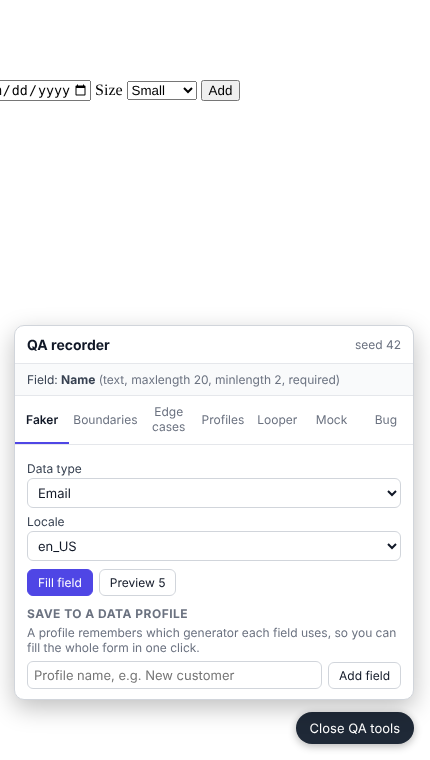
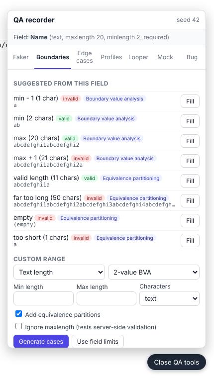
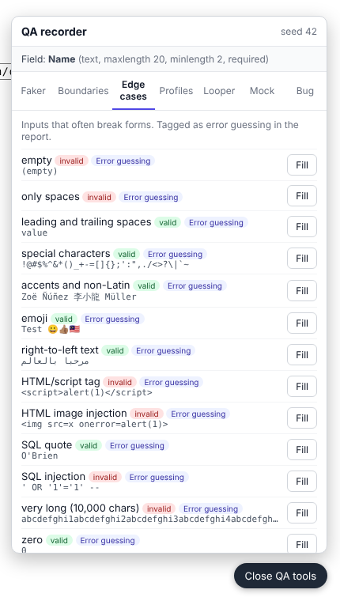
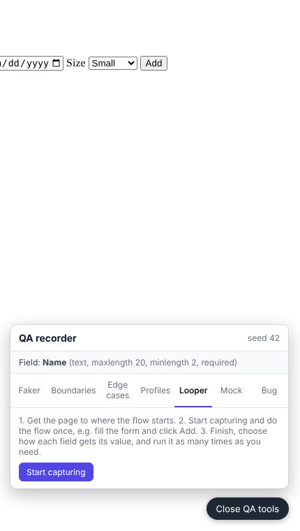
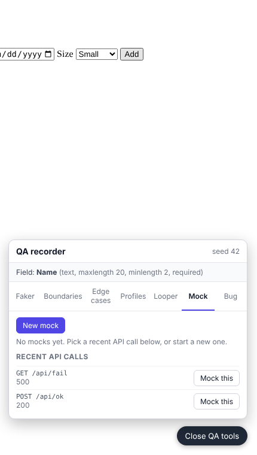
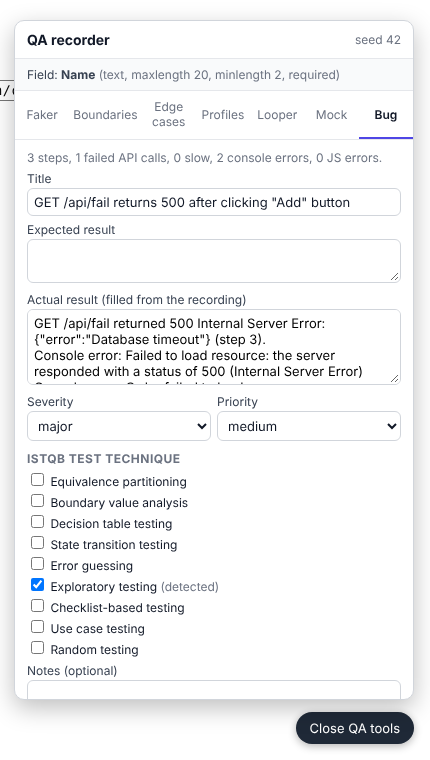

# QA Recorder user guide

QA Recorder is a browser for manual testing. You open the site you are testing, use it as you normally would, and QA Recorder writes down everything that happens: what you clicked and typed, every API call with its status and response time, and every console or JavaScript error. When you find a bug, it turns that recording into a ready-to-file bug report, including the ISTQB test technique you used.

This guide is for testers using the app. For how it works inside, see the [README](../README.md).

**Contents**

1. [Install](#1-install)
2. [Start a recording](#2-start-a-recording)
3. [What gets recorded](#3-what-gets-recorded)
4. [The QA tools panel](#4-the-qa-tools-panel)
5. [Fill fields with test data](#5-fill-fields-with-test-data)
6. [Repeat a flow with the Looper](#6-repeat-a-flow-with-the-looper)
7. [Mock API calls](#7-mock-api-calls)
8. [Write a bug report](#8-write-a-bug-report)
9. [Find your recordings](#9-find-your-recordings)
10. [Test data in the terminal](#10-test-data-in-the-terminal)
11. [Playwright scripts](#11-playwright-scripts)
12. [Tips and troubleshooting](#12-tips-and-troubleshooting)

---

## 1. Install

You need [Node.js](https://nodejs.org) 20 or newer and Git.

```bash
git clone https://github.com/afromugen89/qa-recorder.git
cd qa-recorder
npm install
npm run setup     # downloads the Chromium browser QA Recorder uses
npm run build     # needed once for the `npx qa-recorder` commands
```

Run every command in this guide from the `qa-recorder` folder. After pulling new changes, run `npm install` and `npm run build` again.

## 2. Start a recording

```bash
npm run record -- https://your-app.example.com
```

A Chromium window opens on that page and the terminal says `Recording.` Test the way you normally would. You can leave out `https://`, and you can leave out the URL entirely and type it into the browser yourself.

While you work, the terminal shows each step as it happens:

```
   3.2s click    getByRole("button", { name: "Save", exact: true })
   3.3s POST 200 184ms https://your-app.example.com/api/orders
   7.9s API ERR  GET https://your-app.example.com/api/orders → 500 Internal Server Error in 1240ms
   8.0s CONSOLE  Order failed to load
  12.4s API SLOW GET https://your-app.example.com/api/report → 200 OK in 2310ms
```

- **Red** lines are failures: `API ERR` (4xx, 5xx or network errors), `CONSOLE` (console errors) and `JS ERROR` (uncaught exceptions).
- **Yellow** lines are warnings: `API SLOW` (slower than the threshold, 1 second by default) and console `WARNING`s.
- Grey lines are normal API calls and page navigations.

**To stop**, close the browser window or press **Ctrl+C** in the terminal. QA Recorder prints a summary and the folder it saved to:

```
Saved recordings/2026-11-04_09-15-02/session.json
14 actions, 22 API calls (1 failed, 1 slow, avg 210ms), 1 console errors, 0 uncaught JS errors
```

### Useful options

Put options after the `--`, for example `npm run record -- https://your-app.example.com --slow 500`.

| Option | What it does |
| --- | --- |
| `--slow <ms>` | Flag API calls slower than this. Default `1000`. |
| `-o, --out <dir>` | Save recordings somewhere other than `recordings/`. |
| `--no-screenshots` | Don't take a screenshot after each action. |
| `--keep-secrets` | Record password and card numbers as typed. By default they are masked. |
| `--no-warnings` | Only log console errors, not warnings. |
| `--include-documents` | Also log full page loads, not only XHR and fetch calls. |
| `--no-panel` | Hide the QA tools panel. |
| `--seed <n>` | Reuse a previous seed so generated test data comes out the same. |
| `--mocks <file>` | Use a different mock rules file. Default `.qa-recorder/mocks.json`. |
| `--profiles <file>` | Use a different data profiles file. Default `.qa-recorder/profiles.json`. |
| `--executable <path>` | Use your own Chrome or Chromium instead of the bundled one. |
| `--headless` | Run with no window (for CI). |

Run `npx qa-recorder record --help` to see them all.

## 3. What gets recorded

You don't need to do anything special. Everything below is captured as you test.

**Your actions:** clicks, typing, dropdown selections, radio buttons, checkboxes, key presses and file uploads. This works on elements inside **iframes** (including iframes from another domain) and inside **shadow DOM** (both open and closed). Each action is saved with a Playwright locator for the element, and the terminal shows `(shadow DOM)` when the element was inside one.

**API calls:** method, URL, status code, response time, time to first byte and the request body. For failed calls (4xx, 5xx, network errors) the response body is kept too, so you can see the server's error message. Each API call is linked to the action that caused it, so the report can say *"Clicking Save sent POST /api/orders, which returned 500 in 1.2 s"*.

**Errors:** console errors and warnings, and uncaught JavaScript exceptions.

**Evidence:** a screenshot after every action, and a full network log (HAR file).

**Privacy:** values typed into password and card number fields are masked unless you start with `--keep-secrets`.

## 4. The QA tools panel

Press **Alt+Shift+D** in the page, or click the **QA tools** button at the bottom right. Press it again or click **Close QA tools** to hide it.

The panel has seven tabs: **Faker**, **Boundaries**, **Edge cases**, **Profiles**, **Looper**, **Mock** and **Bug**.

The panel is part of QA Recorder, not of the site you're testing. It never appears in screenshots, your clicks in it aren't recorded as test steps, and it can't affect the site's own tests.

The top of the panel shows which field values will go into. **Click into a field on the page first**, then use the panel. The panel reads the field's rules (type, `maxlength`, `min`, `max`, `required` and so on) and shows them next to the field name.

## 5. Fill fields with test data

Every value the panel puts into a field is labelled with the test technique behind it. That label shows up in the terminal, in `session.json`, and in the steps of your bug report, so the report says exactly what you entered and why.

### Faker tab: realistic random data



1. Click into a field on the page.
2. Choose a **Data type**: name, email, phone, address, company, price, a number range, dates, card numbers, a regex pattern, a template, or any Faker method.
3. Choose a **Locale** if you need data for a specific country.
4. Click **Fill field**, or **Preview 5** to see some values first and pick one.

Some types ask for more, such as min and max for a number, or a pattern like `[A-Z]{3}-[0-9]{4}`. Templates can mix Faker values with a counter, for example `{{person.firstName}}.qa+{i}@test.com`.

Tagged as: **Random testing**.

### Boundaries tab: boundary values and partitions



When you click into a field that has limits, the tab suggests test cases from them, for example min − 1, min, max and max + 1 characters for a text field with `minlength` and `maxlength`. Each case shows whether it should be **valid** or **invalid**. Click **Fill** on a case to use it.

If the field has no limits in the HTML (common when validation happens on the server), use **Custom range**:

1. Choose **Text length**, **Number** or **Date**.
2. Choose **2-value BVA** or **3-value BVA**.
3. Enter the min and max (and a step for decimals, or the character set for text).
4. Leave **Add equivalence partitions** ticked to also get a value from each valid and invalid class.
5. Click **Generate cases**. **Use field limits** brings back the suggestions from the field.

By default a value longer than `maxlength` is cut off, the same as when a real user types it. Tick **Ignore maxlength** to send the full value and test the server's validation instead.

Tagged as: **Boundary value analysis** or **Equivalence partitioning**.

### Edge cases tab: inputs that often break forms



A list of inputs that commonly cause bugs: empty, only spaces, special characters, Unicode, emoji, right-to-left text, HTML and script tags, SQL quotes and injection strings, very long input and number overflow. Click **Fill** on any of them.

Tagged as: **Error guessing**.

### Profiles tab: fill a whole form in one click

A profile remembers which data type goes in which field, so you can refill a form with fresh data every time.

1. On the **Faker** tab, click into the first field, pick its data type, type a profile name (for example *New customer*) and click **Add field**.
2. Repeat for every field in the form, using the same profile name.
3. Next time, open the **Profiles** tab and click **Fill all**.

Profiles are saved to `.qa-recorder/profiles.json`. Commit or share that file and your team gets the same profiles.

Tagged as: **Random testing**.

### Reproducing the same data

Generated data uses a seed, shown at the top right of the panel and saved in `session.json`. To get exactly the same values again, start the recording with `--seed <n>` using that number.

## 6. Repeat a flow with the Looper

The Looper repeats a flow many times with new data each time, for example adding 50 items to a list.



1. Get the page to where the flow starts.
2. On the **Looper** tab, click **Start capturing**.
3. Do the flow once on the page, for example fill the form and click **Add**.
4. Click **Finish capture**. The panel lists the captured steps.
5. For each typed field, choose **Keep recorded value** or a data type to generate a new value each time. A template such as `Item {i}` numbers each iteration.
6. Set **Iterations** and, if needed, a **Pause between** iterations, and tick **Reload the start page before each iteration** if the flow needs a fresh page.
7. Click **Run loop**. The panel shows progress and how many iterations passed. Click **Stop** to end early.

API calls and errors from every iteration are recorded, so a failure in iteration 37 shows up in your bug report. Click **New capture** to record a different flow.

Tagged as: **Random testing** for generated values, and **Use case testing** in the bug report.

## 7. Mock API calls

The **Mock** tab lets you change API requests and responses, so you can test situations that are hard to get from a real server: an expired token, a 500 error, an empty list, a slow response, or an endpoint that doesn't exist yet.



### The quick way

The tab lists recent API calls. Click **Mock this** next to one. The URL and method are filled in for you. Change what you need and click **Save mock**. The next time the page makes that call, your mock applies.

### Writing a mock rule

**Match:** choose a method (or any) and a URL.
- Plain text matches anywhere in the URL: `/api/orders`
- `*` is a wildcard: `/api/orders/*`
- `/.../` is a regular expression: `/\/api\/orders\/\d+$/`

**Before it is sent (request)**
- **Headers to set or remove**, one per line. `Authorization: Bearer expired-token` sets a header, `-X-Request-Id` removes one.
- **JSON fields to change**, one per line. `quantity = 0`, `user.role = "admin"` and `items[0].price = -1` set values, `-coupon` removes a field.
- **Replace the whole body** if you need something completely different.

**After it is sent (response)**, choose one:
- **Don't change the response.**
- **Change the real response:** the server is called, then you change the status code, headers, JSON fields or whole body. For example, set the status to `500` or set `items = []` to test an empty state.
- **Return my response (don't call the server):** you write the status, headers and body. Useful for endpoints that aren't built yet.
- **Simulate a network failure:** failed, timed out, connection refused or offline.

**Delay (ms)** adds N milliseconds to the call, to test spinners and timeouts.

**Only once** switches the rule off after it's used once, for example to make just the first attempt fail and check that a retry works.

**On** turns a rule on or off without deleting it. Use **Edit** to change a rule and **×** to delete it.

### Keep track of what's mocked

While any mock is on, the **QA tools** button turns orange and shows how many are on, for example *QA tools · 2 mocks on*. The terminal also says how many mocks are on when recording starts. Every mocked call is marked `[mocked: <rule name>]` in the terminal and labelled in `session.json` and in bug reports. Reports also warn when mocks were active, so nobody files a bug that the mock caused.

Rules are saved to `.qa-recorder/mocks.json` and stay there between recordings. Commit or share that file and your team gets the same mocks. **Remember to turn mocks off** when you go back to normal testing.

## 8. Write a bug report

### From the panel (recommended)

1. When you hit a bug, open the panel and go to the **Bug** tab.
2. Click **Start bug report**. The form is filled in from your recording:
   - A summary of steps, failed and slow API calls, console errors and JS errors.
   - A suggested **Title** based on the most serious failure and the step that caused it, for example `GET /api/orders returns 500 after clicking "Save" button`.
   - **Actual result** listing the failed API calls with the server's response, uncaught errors, console errors and slow calls.
   - **ISTQB test technique**, ticked automatically based on the test data you used, with *(detected)* next to it.
3. Fill in the **Expected result**, choose **Severity** (critical, major, minor, trivial) and **Priority** (high, medium, low), and add **Notes** if you want.
4. Check the ISTQB technique. Tick or untick techniques if the detected one isn't right, for example tick *Decision table testing* or *State transition testing* if that's how you designed the test.
5. Click **Create bug report**. The terminal prints a `BUG` line with the path to the report.



If you keep testing and find a second bug, the Bug tab lets you choose **Whole session** or **Since last bug**, so each report only contains the steps that matter. Click **Refresh from recording** to pull in anything that happened after you opened the form.

### How the ISTQB technique is detected

| What you did | Technique in the report |
| --- | --- |
| Used the Boundaries tab (BVA cases) | Boundary value analysis |
| Used equivalence partition cases | Equivalence partitioning |
| Used the Edge cases tab | Error guessing |
| Used Faker or Profiles | Random testing |
| Ran the Looper | Use case testing |
| Used none of the data tools | Exploratory testing |

Decision table testing, state transition testing and checklist-based testing can't be detected from the recording, so tick them yourself when they apply.

### What's in the report

Each report is saved in `recordings/<session>/bugs/<nn>-<title>/` as three files:

| File | Use it to |
| --- | --- |
| `report.html` | Open in a browser, print, or attach to a ticket. Screenshots are embedded, so it's one file. |
| `report.md` | Paste into Jira, GitHub or Azure DevOps. |
| `bug.json` | Import into other tools. |

A report contains:

- Environment: start URL, browser and user agent, when it was recorded, and the test data seed
- Numbered **steps to reproduce** in plain English, with the test data and technique for each generated value and whether it was expected to be valid or invalid
- Expected and actual results
- The ISTQB technique and why it was chosen
- Failed API calls with request and response bodies
- Slow API calls
- Console and JavaScript errors, linked to the step that caused them
- **API response times per endpoint**: number of calls, errors, average, p95 and max
- Screenshots and the full timeline
- A warning if any mocks were active

### From the terminal, after recording

If you closed the browser without writing a report, the terminal suggests a command. You can write one from any saved recording:

```bash
npx qa-recorder report recordings/2026-11-04_09-15-02 \
  --title "Order list fails to load" \
  --expected "Orders are shown" \
  --severity major --priority high --technique bva,eg
```

| Option | Meaning |
| --- | --- |
| `--title`, `--expected`, `--actual`, `--notes` | Report text. Title and actual result are suggested from the recording if you leave them out. |
| `--severity` | `critical`, `major`, `minor` or `trivial` |
| `--priority` | `high`, `medium` or `low` |
| `--technique` | Comma-separated: `bva`, `ep`, `dt` (decision table), `st` (state transition), `eg` (error guessing), `exploratory`, `checklist`, `use-case`, `random`. Detected automatically if left out. |
| `--reporter <name>` | Your name on the report. |
| `--from-seq <n>`, `--to-seq <n>` | Only include part of the timeline. |

## 9. Find your recordings

Each recording is saved in its own timestamped folder:

```
recordings/2026-11-04_09-15-02/
  session.json      every event in order, plus a summary
  network.har       full network log
  screenshots/      one PNG after each action
  bugs/             bug reports written in this session
```

- **`network.har`** opens in Chrome DevTools (Network tab, then drag the file in) or any HAR viewer.
- **`session.json`** is the full timeline. Each event has a `type`: `action`, `network`, `console`, `pageerror`, `navigation`, `loop` or `bug`. It also holds the seed for generated data and a summary of API calls, failures, slow calls and average response time.

## 10. Test data in the terminal

You can generate the same test data without opening a browser, for example to paste into a test case.

```bash
npx qa-recorder data types                         # list all data types
npx qa-recorder data fake email -n 10              # 10 emails
npx qa-recorder data fake name --locale de -n 5    # 5 German names
npx qa-recorder data fake pattern --pattern "[A-Z]{3}-[0-9]{4}"
npx qa-recorder data fake template --template "{{person.firstName}}.qa+{i}@test.com" -n 5
npx qa-recorder data bva --min 1 --max 99 --three --partitions   # number boundaries
npx qa-recorder data length --min 2 --max 50 --charset email     # text-length boundaries
npx qa-recorder data date --min 2026-01-01 --max 2026-12-31      # date boundaries
npx qa-recorder data edge                                       # error-guessing inputs
```

Boundary commands print each value with valid or invalid and its technique. Add `--seed <n>` to `data fake` to get the same values every time.

## 11. Playwright scripts

QA Recorder does not export a ready-to-run Playwright test file yet. That is on the roadmap.

What it does today: every recorded action in `session.json` carries a Playwright locator you can copy into your own tests:

```json
"locator": {
  "code": "getByRole(\"button\", { name: \"Save\", exact: true })"
},
"framePath": ["#checkout-frame"]
```

- `code` is the locator to use after `page.` (or after the frame, see below). The same text appears in the terminal as you record.
- `framePath` lists the iframes the element is inside. Use `page.frameLocator('#checkout-frame').getByRole(...)`.
- Locators prefer, in order: a test id (`data-testid`, `data-test`, `data-qa`, `data-cy`), role and accessible name, label, placeholder, `name`, a stable `id`, and finally a CSS path. If several elements match, `.nth()` is added.
- Elements inside **closed** shadow DOM are recorded for the bug report, but Playwright can't reach them, so they are flagged with `"inClosedShadowDom": true`.

## 12. Tips and troubleshooting

- **The panel doesn't show the field I clicked.** Click directly into the input on the page (not its label) and check the field name at the top of the panel.
- **A value was cut short.** The field has a `maxlength`. Tick **Ignore maxlength** on the Boundaries tab to send the full value.
- **The app behaves strangely, or API calls return odd data.** Check whether the QA tools button is orange. If it is, a mock is on. Turn it off on the Mock tab.
- **I want different data but the same steps.** Start a new recording without `--seed`. To get the *same* data, reuse the seed from the panel or `session.json`.
- **Too many yellow warnings in the terminal.** Start with `--no-warnings` to log console errors only.
- **Everything is flagged as slow.** Raise the threshold, for example `--slow 2000`.
- **`npx qa-recorder` says it can't find the command.** Run `npm run build` in the `qa-recorder` folder first.
- **The browser didn't open.** Run `npm run setup` to download Chromium, or point to your own browser with `--executable`.
